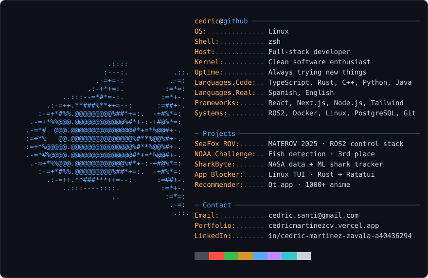

<picture>
  <source media="(prefers-color-scheme: dark)" srcset="dark_mode.svg">
  <source media="(prefers-color-scheme: light)" srcset="light_mode.svg">
  
</picture>

<a href="mailto:cedric.santi@gmail.com">email</a> ·
<a href="https://cedricmartinezcv.vercel.app/">portfolio</a> ·
<a href="https://www.linkedin.com/in/cedric-martinez-zavala-a40436294/">linkedin</a> ·
<a href="https://github.com/SeaFoxROV/MATEROV_SeaFox_2025">seafox-rov</a> ·
<a href="https://github.com/SeaFoxROV/ComputerCodingChallenge2025">noaa-challenge</a> ·
<a href="https://github.com/Alejandrop22/sharkByte">sharkbyte</a> ·
<a href="https://github.com/CedricMrtz/WIP-Terminal-App-Blocker">app-blocker</a> ·
<a href="https://github.com/CedricMrtz/recommendation-algorithm">recommender</a>

